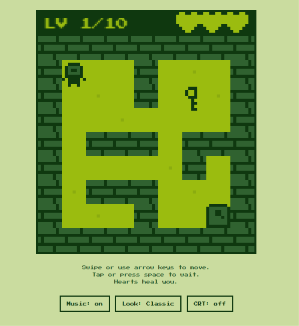

# Tiny Dungeon


A tiny turn-based pixel dungeon crawler in Game Boy green. Grab the key, dodge the slimes, outsmart the ghosts, and reach the door. It is a single HTML file with no dependencies, no build step, and no audio files.

**[Play it live](https://tambesujal406-design.github.io/tiny-dungeon/)**

## Features

- 10 hand-built rooms, each checked by a solver to be beatable without taking damage
- Turn-based movement: enemies only move when you do, so every step is a decision
- Three enemy types: horizontal slimes, vertical slimes, and chasing ghosts
- Hearts: 3 lives that carry across rooms, with heart pickups to heal
- Chiptune background music generated live with the Web Audio API
- Works on phones (swipe and tap) and desktop (keyboard)
- 5 colour looks you can switch live (Classic Game Boy, Neon, Blood, Amber, Ice), plus an optional CRT scanline mode
- Your look, CRT, and mute choices are remembered on your device

## Controls

| Action | Touch | Keyboard |
| --- | --- | --- |
| Move one tile | Swipe | Arrow keys or WASD |
| Wait one turn | Tap | Space |
| Mute music | Music button | Music button |
| Change colour look | Look button | Look button |
| CRT scanlines on or off | CRT button | CRT button |

Bumping into a wall also counts as a wait, which lets you time your crossings.

## Run locally

No install is needed. Open `index.html` in a browser, or serve the folder:

```bash
git clone https://github.com/tambesujal406-design/tiny-dungeon.git
cd tiny-dungeon
npm start        # serves http://localhost:8000
```

## Add your own room

Rooms live in the `LV` array near the top of the script in `index.html`. Each room is 9 rows of 9 characters:

| Char | Meaning |
| --- | --- |
| `#` | Wall |
| `.` | Floor |
| `@` | Player start (exactly one) |
| `D` | Locked door (exactly one) |
| `k` | Key (exactly one) |
| `+` | Heart pickup |
| `h` | Slime that patrols left and right |
| `v` | Slime that patrols up and down |
| `c` | Ghost that chases you every second turn |

Then check that every room is well formed and solvable:

```bash
npm run check
```

The checker runs a breadth-first search over every possible game state, so it tells you when a room is impossible before anyone plays it.

## Project structure

```
index.html                 the whole game (HTML, CSS, JS)
scripts/check-levels.mjs   room validator and solver
.github/workflows/         CI checks and GitHub Pages deploy
```

## Deploy your own copy

1. Fork this repo or push it to your own GitHub account.
2. Go to **Settings > Pages** and set **Source** to **GitHub Actions**.
3. Push to `main`. The workflow checks the rooms, then publishes the site.

## Roadmap

- [ ] In-browser level editor
- [ ] Torch-light mode with a dithered field of view
- [ ] Sound effects for steps, keys, and hits
- [ ] Boss room
- [ ] Best-room and speedrun timer saved on device

## Contributing

Ideas, bug reports, and new rooms are welcome. See [CONTRIBUTING.md](CONTRIBUTING.md).

## License

[MIT](LICENSE) (c) 2026 Sujal Tambe
